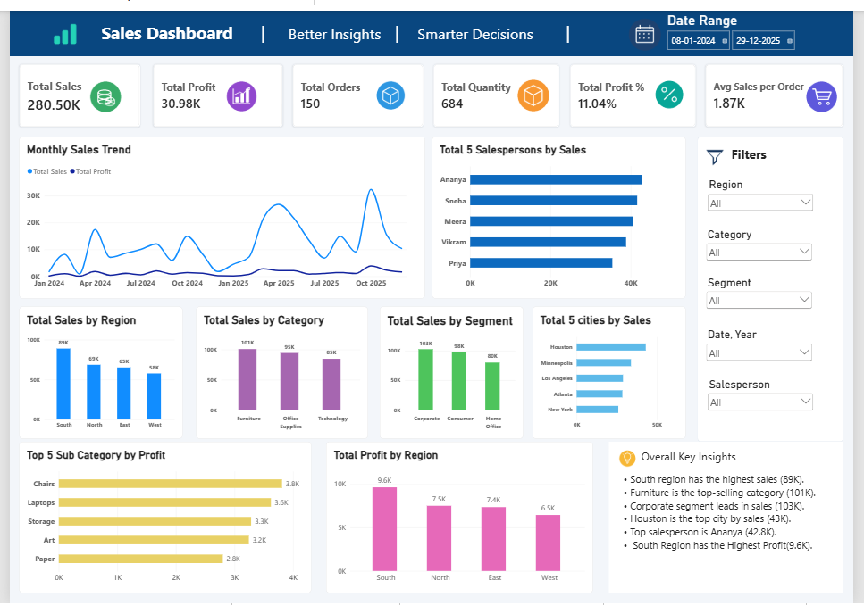

# Power BI Sales Analysis Dashboard

## Project Overview

This project presents an interactive Sales Analysis Dashboard built using Microsoft Power BI. It helps explore sales performance, profitability, regional trends, product categories, customer segments, cities, and salesperson performance.

## Dashboard Preview

## Tools Used

* Microsoft Power BI Desktop
* DAX (Data Analysis Expressions)
* Data Visualization
* Interactive Slicers and Filtering

## Dashboard Features

### KPI Cards

* Total Sales
* Total Profit
* Total Orders
* Total Quantity
* Profit Margin
* Average Sales per Order

### Sales Analysis

* Monthly Sales and Profit Trend
* Sales by Region
* Sales by Category
* Sales by Segment
* Top 5 Cities by Sales
* Top 5 Salespersons by Sales

### Profit Analysis

* Top 5 Sub-Categories by Profit
* Profit by Region

### Interactive Features

* Region Filter
* Category Filter
* Segment Filter
* Date Range Filter
* Salesperson Filter

## Business Questions

This dashboard helps answer questions such as:

1. Which region generates the highest sales?
2. Which product category contributes the most sales?
3. Which segment performs best in sales?
4. Which cities generate the highest sales?
5. Which salespersons have the highest sales?
6. Which product sub-categories generate the most profit?
7. How do sales and profit change over time?

## Key Findings

* South is the leading region in sales in the current report.
* Furniture is the leading category by sales.
* Corporate is the leading segment by sales.
* Ananya is the top salesperson in the current report.

These findings should be checked against the final dashboard values before publication.

## Project Files

* `Sales_Analysis_Dashboard.pbix` — Power BI report file.
* `Sales_Dashboard_Preview.png` — Dashboard preview image.

## Dataset

The project uses a practice sales dataset containing approximately 150 records.

Add the dataset source or attribution here if applicable. Include the dataset file only when redistribution is permitted.

## What I Learned

* Creating and formatting Power BI visuals.
* Building DAX measures for sales and profitability.
* Using slicers to interactively explore data.
* Comparing performance across regions, categories, segments, cities, and salespersons.
* Presenting business findings through an interactive dashboard.
